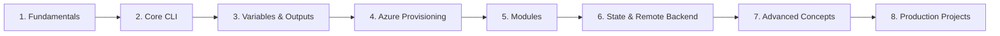

# 🚀 Terraform & Azure Cloud: 30-Day Learning Journey

[](https://www.terraform.io/)
[](https://azure.microsoft.com/)
[](LICENSE)
[](https://github.com/)
[](https://github.com/)

> *"Automating the cloud, one commit at a time."*  
> Welcome to my hands-on documentation repository where I track my daily journey mastering **Terraform** and **Microsoft Azure**. Here, I document practical labs, real-world infrastructure designs, code patterns, and key DevOps takeaways.

---

## 📌 Table of Contents

- [About The Journey](#-about-the-journey)
- [Why Infrastructure as Code (IaC)?](#-why-infrastructure-as-code-iac)
- [Technology Stack](#-technology-stack)
- [Comprehensive Learning Roadmap](#-comprehensive-learning-roadmap)
- [30-Day Learning Plan & Syllabus](#-30-day-learning-plan--syllabus)
- [Repository Structure](#-repository-structure)
- [Daily Learning Progress Tracker](#-daily-learning-progress-tracker)
- [Hands-On Practical Projects](#-hands-on-practical-projects)
- [Essential Terraform Command Reference](#-essential-terraform-command-reference)
- [Security & State Management Best Practices](#-security--state-management-best-practices)
- [GitHub Contribution Goal](#-github-contribution-goal)
- [Official Documentation & Resources](#-official-documentation--resources)
- [Connect With Me](#-connect-with-me)

---

## 📖 About The Journey

This repository serves as a live, open-source portfolio and public learning log of my path to becoming a proficient DevOps Engineer. 

As a beginner in Cloud & Infrastructure as Code, my objective is not just to run tutorials, but to deeply understand:
- Declarative infrastructure patterns and idempotent execution.
- Production-ready cloud architecture on **Microsoft Azure**.
- Industry-standard modular design, state isolation, and enterprise security guardrails.

Every day includes code written from scratch, tested with the Azure provider, peer-reviewed against HashiCorp best practices, and pushed to this repo with detailed documentation.

---

## 💡 Why Infrastructure as Code (IaC)?

Modern engineering teams build, scale, and decommission infrastructure through code rather than manual portal clicks ("ClickOps").

| Challenge with Manual Provisioning | Solution with Terraform & IaC |
| :--- | :--- |
| **Human Error & Drift** | Version-controlled, repeatable, self-documenting code |
| **Slow Deployments** | Automated, parallel execution in minutes |
| **Inconsistent Environments** | Reusable templates guarantee dev/staging/prod parity |
| **No Audit Trail** | Git history tracks who made what change and when |
| **Cost Spikes** | Predictable planning (`terraform plan`) and rapid cleanup (`terraform destroy`) |

---

## 🛠️ Technology Stack

| Technology | Purpose | Badge |
| :--- | :--- | :--- |
| **Terraform** | Core IaC engine for provisioning declarative resources |  |
| **Microsoft Azure** | Target enterprise cloud platform & services |  |
| **Azure CLI (`az`)** | Cloud authentication, service principal configuration & verification |  |
| **Git & GitHub** | Source control, daily progress tracking & version management |  |
| **PowerShell** | Cross-platform scripting & automation on Windows |  |
| **Linux (Bash)** | VM compute OS, remote management, cloud-init scripts |  |

---

## 🗺️ Comprehensive Learning Roadmap

The learning path is structured systematically across 8 progressive milestones:



1. **Terraform Fundamentals**: Core architecture, provider ecosystem, declarative syntax (HCL), resource blocks, and dependency graphs.
2. **Terraform Commands**: Deep dive into workflow commands (`init`, `validate`, `fmt`, `plan`, `apply`, `destroy`, `refresh`).
3. **Variables and Outputs**: Input variables, default values, validation rules, type constraints, `locals`, and output values.
4. **Azure Infrastructure Provisioning**: Resource Groups, Virtual Networks, Subnets, Network Security Groups, Public IPs, and NICs.
5. **Terraform Modules**: Reusable module architecture, child vs. root modules, inputs/outputs, and public registry consumption.
6. **Remote Backend and State Management**: State locking, remote storage in Azure Blob Storage, state migration, inspect & repair (`terraform state`).
7. **Advanced Terraform Concepts**: Dynamic blocks, `for_each`, `count`, splat syntax, built-in functions, lifecycle rules, and provisioners.
8. **Real-World Projects**: Multi-tier web applications, hub-and-spoke networking, secure secrets integration with Azure Key Vault.

---

## 📅 30-Day Learning Plan & Syllabus

<details open>
<summary><b>Click to expand the 30-Day Day-Wise Curriculum</b></summary>

| Day | Topic | Hands-on Practical Task |
| :---: | :--- | :--- |
| **Day 01** | Introduction to IaC & Terraform Architecture | Install Terraform & Azure CLI, authenticate via `az login` |
| **Day 02** | HCL (HashiCorp Configuration Language) Basics | Write first `main.tf` and declare the `azurerm` provider block |
| **Day 03** | Core Workflow & First Resource | Provision an Azure Resource Group using `init`, `plan`, `apply` |
| **Day 04** | Understanding Terraform State (`terraform.tfstate`) | Inspect local state file; observe desired state vs. actual state |
| **Day 05** | Input Variables & Data Types | Parameterize resource group name and location with `string` & `list` |
| **Day 06** | Local Values & Output Values | Implement `locals` for resource naming conventions & export resource IDs |
| **Day 07** | Azure Virtual Networking (VNet & Subnet) | Deploy a custom VNet with dual subnets (`frontend` and `backend`) |
| **Day 08** | Network Security Groups (NSGs) & Security Rules | Configure inbound SSH (port 22) and HTTP (port 80) firewall rules |
| **Day 09** | Azure Public IP & Network Interface (NIC) | Provision dynamic/static public IPs and bind them to a network adapter |
| **Day 10** | Linux Virtual Machine Provisioning | Deploy an Ubuntu Linux VM (`azurerm_linux_virtual_machine`) with SSH keys |
| **Day 11** | VM Bootstrapping with Custom Data | Pass a bash user-data script to automatically install Nginx on VM boot |
| **Day 12** | Terraform Formatting & Static Validation | Clean code with `terraform fmt -check` and run `terraform validate` |
| **Day 13** | Resource Dependencies (`depends_on`) | Contrast implicit dependency vs. explicit dependency with practical labs |
| **Day 14** | Multi-Resource Creation (`count` vs. `for_each`) | Provision multiple subnets and NSG rules using maps and `for_each` |
| **Day 15** | Conditional Expressions & Built-in Functions | Use ternary conditions (`condition ? true : false`) and functions (`lookup`, `join`) |
| **Day 16** | Terraform Lifecycle Arguments | Implement `create_before_destroy`, `prevent_destroy`, and `ignore_changes` |
| **Day 17** | Data Sources (`data` blocks) | Query existing Azure subscriptions and images without managing them |
| **Day 18** | Introduction to Terraform Modules | Refactor standalone network code into a self-contained local module |
| **Day 19** | Child and Root Module Communication | Pass variables from root to child module and expose child outputs |
| **Day 20** | Reusable Azure Compute Module | Build a standardized, parameter-driven VM module for reuse |
| **Day 21** | Remote State Backend (Azure Storage Account) | Create an Azure Storage Container and configure `backend "azurerm"` |
| **Day 22** | State Locking with Azure Blob Leases | Test concurrent plan execution to observe blob lease locking |
| **Day 23** | Terraform State Commands | Practice `terraform state list`, `show`, `mv`, and state backup routines |
| **Day 24** | Azure Key Vault Integration | Store database credentials in Azure Key Vault and fetch via data source |
| **Day 25** | Secrets Management & Security Scanning | Configure `.gitignore`, scan code with `tfsec` / `trivy`, secure variables |
| **Day 26** | Multi-Environment Architecture (`dev` / `prod`) | Structure directory-based environments with distinct backend states |
| **Day 27** | Mini Project: 2-Tier Secure Web Architecture | Build Web VM + Database Subnet with dedicated NSGs and private routing |
| **Day 28** | Infrastructure Testing & Code Quality | Run linting, validation pipelines, and test idempotency |
| **Day 29** | Cost Estimation & Cleanup Optimization | Analyze resource costs, review `terraform plan` diffs, safely destroy |
| **Day 30** | Capstone Review & Open Source Portfolio Showcase | Polish documentation, publish module diagrams, write recap article |

</details>

---

## 📂 Repository Structure

The repository is organized following HashiCorp-recommended directory standards to separate daily exercises, reusable modules, and end-to-end environments:

```plaintext
terraform-azure-learning-journey/
│
├── .github/
│   └── workflows/              # GitHub Actions CI for terraform fmt & validate
│
├── 01-daily-labs/              # Step-by-step daily exercises (Day 01 - Day 30)
│   ├── day-01-intro-and-setup/
│   ├── day-02-hcl-syntax/
│   ├── day-03-first-resource-group/
│   │   ├── main.tf
│   │   ├── variables.tf
│   │   ├── outputs.tf
│   │   └── README.md
│   └── ...
│
├── 02-azure-core-resources/    # Standalone resource configurations
│   ├── resource-groups/
│   ├── virtual-networks/
│   ├── network-security-groups/
│   ├── storage-accounts/
│   └── linux-vms/
│
├── 03-modules/                 # Reusable custom Terraform modules
│   ├── azure-vnet/
│   │   ├── main.tf
│   │   ├── variables.tf
│   │   ├── outputs.tf
│   │   └── README.md
│   └── azure-linux-vm/
│       ├── main.tf
│       ├── variables.tf
│       ├── outputs.tf
│       └── README.md
│
├── 04-environments/            # Multi-environment deployment configurations
│   ├── dev/
│   │   ├── main.tf
│   │   ├── backend.tf
│   │   └── terraform.tfvars
│   └── prod/
│       ├── main.tf
│       ├── backend.tf
│       └── terraform.tfvars
│
├── 05-capstone-projects/       # End-to-end practical real-world architectures
│   ├── project-01-remote-backend/
│   └── project-02-two-tier-web-app/
│
├── docs/                       # Cheatsheets, architecture diagrams, notes
│   ├── architecture-diagrams/
│   └── commands-cheatsheet.md
│
├── .gitignore                  # Strict exclusion of state files, secrets & cache
├── LICENSE                     # Open source license
└── README.md                   # Repository landing page and tracker
```

---

## 📊 Daily Learning Progress Tracker

This checklist tracks my daily consistency. *(Updated upon every push)*

- [ ] **Day 01**: Introduction to IaC, Terraform Architecture & Azure CLI Setup
- [ ] **Day 02**: HCL Fundamentals & Azure Provider Configuration
- [ ] **Day 03**: First Azure Resource Group Provisioning
- [ ] **Day 04**: Understanding Local Terraform State Management
- [ ] **Day 05**: Input Variables, Default Values & Type Constraints
- [ ] **Day 06**: Local Values (`locals`) & Resource Output Values
- [ ] **Day 07**: Azure Virtual Networks (VNet) & Subnet Architecture
- [ ] **Day 08**: Network Security Groups (NSGs) & Stateful Inbound Rules
- [ ] **Day 09**: Azure Public IPs & Network Interface Cards (NIC)
- [ ] **Day 10**: Provisioning Ubuntu Linux Virtual Machine with SSH Keys
- [ ] **Day 11**: Bootstrapping Linux VM via Custom Data / Cloud-Init
- [ ] **Day 12**: Terraform Code Quality (`fmt`, `validate`)
- [ ] **Day 13**: Resource Dependencies (`depends_on` explicit vs implicit)
- [ ] **Day 14**: Meta-arguments: `count` vs `for_each` with Map Iteration
- [ ] **Day 15**: Dynamic Expressions, Built-in Functions & Ternary Logic
- [ ] **Day 16**: Resource Lifecycle Hooks (`prevent_destroy`, `create_before_destroy`)
- [ ] **Day 17**: Querying Existing Azure Infrastructure with Data Sources
- [ ] **Day 18**: Modularization: Building a Custom Azure VNet Module
- [ ] **Day 19**: Child-Root Module Data Flow & Output Delegation
- [ ] **Day 20**: Reusable Compute Module with Dynamic Disk Sizing
- [ ] **Day 21**: Azure Remote Backend (Storage Account + Blob Container)
- [ ] **Day 22**: Distributed State Locking using Azure Blob Lease Lock
- [ ] **Day 23**: Advanced State Inspection & Refactoring (`terraform state`)
- [ ] **Day 24**: Azure Key Vault Integration for Secure Secret Consumption
- [ ] **Day 25**: Security Hardening, Trivy/tfsec Scanning & Secret Hygiene
- [ ] **Day 26**: Multi-Environment Organization (`dev` vs `prod` state isolation)
- [ ] **Day 27**: Capstone Project: 2-Tier Scalable Web Infrastructure
- [ ] **Day 28**: Pipeline Validation with GitHub Actions
- [ ] **Day 29**: FinOps Basics: Cost Estimation & Idempotency Testing
- [ ] **Day 30**: Challenge Completion & Comprehensive Retrospective

---

## 🏗️ Hands-On Practical Projects

The exercises culminate in production-inspired infrastructure deployments:

### 1. Azure Resource Group & Governance
- Provision environment-tagged resource groups adhering to cloud naming conventions.
- Standardized tagging schema (`Environment`, `ManagedBy`, `Project`, `Owner`).

### 2. Isolated Virtual Network & Subnet Topology
- Virtual network deployment with distinct CIDR blocks (`10.0.0.0/16`).
- Multi-tier subnet segmentation: `Public-Subnet` (`10.0.1.0/24`) and `Private-Subnet` (`10.0.2.0/24`).

### 3. Layered Network Security Group (NSG) Rules
- Micro-segmentation with custom inbound priority rules.
- Restricting SSH access (22) to specific IP blocks and exposing HTTP (80) publicly.

### 4. Fully Automated Linux Compute Instance
- Azure Linux Virtual Machine deployed with zero interactive prompts.
- SSH public key injection and automated Nginx web server installation via `custom_data`.

### 5. Enterprise Terraform Modules
- Encapsulated reusable network and compute modules with clear input validations.
- Documented module contracts (`README.md`, inputs, outputs, default fallbacks).

### 6. Production Remote Backend with State Locking
- Provisioning an Azure Storage Account and Blob Container dedicated to remote state.
- Native Azure Blob storage locking mechanisms to prevent simultaneous `apply` operations.

---

## ⚡ Essential Terraform Command Reference

| Command | Description | Example Usage |
| :--- | :--- | :--- |
| `terraform init` | Initializes backend, downloads provider plugins and modules | `terraform init -upgrade` |
| `terraform validate` | Verifies syntax and configuration correctness without cloud calls | `terraform validate` |
| `terraform fmt` | Formats all HCL files to HashiCorp standard indentation | `terraform fmt -recursive` |
| `terraform plan` | Generates execution plan; compares state against real cloud resources | `terraform plan -out=tfplan` |
| `terraform apply` | Applies the changes required to reach desired configuration | `terraform apply "tfplan"` |
| `terraform destroy` | Destroys all remote objects managed by the configuration | `terraform destroy` |
| `terraform show` | Inspects state file or a saved plan in human-readable format | `terraform show` |
| `terraform state list`| Lists all tracked resource addresses in the current state | `terraform state list` |
| `terraform output` | Reads and extracts values from the state file | `terraform output -json` |
| `terraform console` | Interactive REPL console to evaluate expressions and functions | `terraform console` |

---

## 🔐 Security & State Management Best Practices

> [!CAUTION]
> **Never commit sensitive credentials, secret keys, or `.tfstate` files to public GitHub repositories.**

### Critical Rules Followed in This Repo:
1. **State Isolation**: Terraform state files (`.tfstate`) contain plain-text resource metadata, including passwords and connection strings. State is always pushed to secure remote backend storage with encryption at rest and in transit.
2. **Strict `.gitignore`**: The repository maintains a hardened `.gitignore` preventing accidental leaks:
   ```gitignore
   # Local .terraform directories
   **/.terraform/*

   # .tfstate files
   *.tfstate
   *.tfstate.*
   *.tfstate.backup

   # Variable definitions containing secrets
   *.tfvars
   *.tfvars.json
   override.tf
   override.tf.json
   *_override.tf
   *_override.tf.json

   # Crash log files
   crash.log
   crash.*.log

   # Azure CLI credentials cache
   .azure/
   ```
3. **No Hardcoded Secrets**: Service Principal credentials and API keys are passed strictly through environment variables (`ARM_CLIENT_ID`, `ARM_CLIENT_SECRET`, `ARM_SUBSCRIPTION_ID`, `ARM_TENANT_ID`) or Azure Key Vault references.
4. **Static Code Analysis**: All code blocks are periodically checked for misconfigurations and security vulnerabilities using open-source scanners (`trivy`, `tfsec`).

---

## 🎯 GitHub Contribution Goal

- **Daily Pushes**: Commit structured code, test runs, and daily notes every single day.
- **Meaningful Commit Messages**: Follow [Conventional Commits](https://www.conventionalcommits.org/) standards (e.g., `feat(network): add subnet delegation for app services`, `docs(day-08): update nsg firewall notes`).
- **Transparency**: Document hurdles, troubleshooting steps, and exact errors encountered along with their resolutions.

---

## 📚 Official Documentation & Resources

- 🌐 [HashiCorp Terraform Documentation](https://developer.hashicorp.com/terraform/docs)
- 🌐 [Terraform AzureRM Provider Registry](https://registry.terraform.io/providers/hashicorp/azurerm/latest/docs)
- 🌐 [Microsoft Learn: Terraform on Azure](https://learn.microsoft.com/en-us/azure/developer/terraform/)
- 🌐 [Azure Architecture Center](https://learn.microsoft.com/en-us/azure/architecture/)
- 🌐 [GitHub Documentation](https://docs.github.com/)

---

## 🤝 Connect With Me

If you are a DevOps enthusiast, Cloud Architect, recruiter, or fellow learner, feel free to connect:

- **Author**: Your Name
- **GitHub**: [@YourGitHubProfile](https://github.com/)
- **LinkedIn**: [Your LinkedIn Profile](https://linkedin.com/in/)
- **Repository**: [terraform-azure-learning-journey](https://github.com/)

---

<p align="center">
  ⭐ <b>Star this repository</b> if you find this journey helpful or inspiring!
</p>

