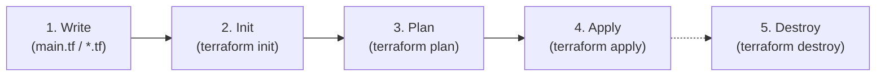

# 📅 Day 01: Introduction to Terraform & Infrastructure as Code (IaC)

## 📌 Overview

Welcome to **Day 01** of the Terraform & Azure Learning Journey! Today marks the starting point where we transition from manual cloud configuration ("ClickOps") to automated, declarative **Infrastructure as Code (IaC)**.

The objective of today's lab is to understand what Terraform is, how its architecture works, set up the development environment, and configure the Azure provider.

---

## 🎯 Day 01 Objectives

- [x] Understand what Infrastructure as Code (IaC) is and why it matters.
- [x] Learn core Terraform concepts: Declarative syntax, State, and Providers.
- [x] Install & verify Terraform CLI and Azure CLI on the local machine.
- [x] Authenticate to Microsoft Azure using Azure CLI (`az login`).
- [x] Understand the structure of `terraform.tf` and `main.tf`.
- [x] Initialize the working directory with `terraform init`.

---

## 💡 What is Infrastructure as Code (IaC)?

**Infrastructure as Code (IaC)** is the practice of managing and provisioning computing infrastructure (networks, virtual machines, load balancers, storage, etc.) through machine-readable definition files, rather than physical hardware configuration or interactive configuration tools.

### Why IaC Over "ClickOps" (Manual Azure Portal)?

| Feature | Manual Portal (ClickOps) | Infrastructure as Code (Terraform) |
| :--- | :--- | :--- |
| **Speed** | Slow, repetitive manual clicks | Automated and executes in minutes |
| **Consistency** | High risk of human error & drift | 100% reproducible environments |
| **Version Control** | No rollback or audit history | Full Git history, branch reviews, PRs |
| **Documentation** | External docs quickly become outdated | Code serves as living documentation |
| **Destruction/Cleanup**| Prone to leaving orphaned resources | Clean, single-command teardown (`destroy`)|

---

## 🧩 What is Terraform?

**Terraform** is an open-source Infrastructure as Code tool created by **HashiCorp**. It allows you to define cloud and on-premises resources in human-readable configuration files that you can version, reuse, and share.

### Key Characteristics:
1. **Declarative**: You define **what** infrastructure you want (the desired state), and Terraform figures out **how** to create or update it.
2. **Provider-Agnostic**: Works with Microsoft Azure, AWS, Google Cloud, Kubernetes, and hundreds of SaaS providers.
3. **State-Driven**: Terraform maintains a state file (`terraform.tfstate`) to map your real-world resources to your configuration.
4. **Execution Plan**: Terraform generates an explicit plan (`terraform plan`) showing exactly what will be added, changed, or destroyed before making any changes.

---

## 🔄 The Core Terraform Workflow

Every Terraform project follows the standard four-stage lifecycle:



1. **Write**: Author declarative infrastructure configurations in HashiCorp Configuration Language (HCL).
2. **Init**: Initialize the working directory, download required provider plugins (e.g., `azurerm`), and set up backend state.
3. **Plan**: Preview the execution plan. Terraform compares your code with current cloud state and reports proposed changes.
4. **Apply**: Execute the plan to provision or update resources in Microsoft Azure.
5. **Destroy**: Clean up and tear down all managed infrastructure when it is no longer needed.

---

## ⚙️ Environment Setup & Prerequisites

Before writing any Terraform code for Azure, ensure the required CLI tools are installed and verified:

### 1. Verify Terraform CLI Installation
```powershell
terraform -version
```
*Expected Output: `Terraform v1.x.x`*

### 2. Verify Azure CLI Installation
```powershell
az --version
```
*Expected Output: `azure-cli 2.x.x`*

### 3. Authenticate with Microsoft Azure
Run the login command in PowerShell or terminal to authenticate your session:
```powershell
az login
```
*A browser window opens to log into your Azure subscription.*

To verify your active subscription:
```powershell
az account show --output table
```

If you have multiple subscriptions, select your target subscription:
```powershell
az account set --subscription "<SUBSCRIPTION_ID_OR_NAME>"
```

---

## 📁 Day 01 File Structure & Purpose

In this folder, we keep our configuration modular:

```plaintext
day1-Terraform introduction/
│
├── terraform.tf        # Specifies required Terraform version & required provider versions
├── main.tf             # Provider block configuration (azurerm) and features
└── README.md           # Day 1 lab notes, theory, and commands guide
```

### 1. `terraform.tf` (Requirements Block)
Defines which version of Terraform and which providers are required:
```hcl
terraform {
  required_version = ">= 1.5.0"

  required_providers {
    azurerm = {
      source  = "hashicorp/azurerm"
      version = "~> 3.0"
    }
  }
}
```

### 2. `main.tf` (Provider Block)
Configures the Azure Resource Manager (`azurerm`) provider. The `features {}` block is required by the AzureRM provider:
```hcl
provider "azurerm" {
  features {}
}
```

---

## 🚀 Hands-On: Running Your First Command

Open your terminal in the `day1-Terraform introduction` directory:

```powershell
# 1. Format the code according to HCL styling standards
terraform fmt

# 2. Initialize the directory and download the Azure provider plugin
terraform init

# 3. Validate configuration syntax and internal consistency
terraform validate
```

### What happens when you run `terraform init`?
1. Checks `terraform.tf` for required providers.
2. Downloads the official `hashicorp/azurerm` plugin into a hidden `.terraform/` folder.
3. Generates a dependency lock file named `.terraform.lock.hcl` to ensure version consistency across all team members.

---

## 📝 Key Commands Reference (Day 01)

| Command | Purpose |
| :--- | :--- |
| `terraform -version` | Displays the installed Terraform version |
| `az login` | Authenticates Azure CLI with your Microsoft Azure account |
| `az account show` | Displays active Azure subscription details |
| `terraform init` | Initializes project, downloads providers and modules |
| `terraform fmt` | Rewrites configuration files to canonical format and style |
| `terraform validate` | Validates syntax and arguments without accessing cloud APIs |

---

## ⚠️ Key Learnings & Important Tips

> [!NOTE]
> The `features {}` block inside `provider "azurerm" {}` is mandatory even if left empty. It controls provider-specific behaviors (such as key vault soft-delete policies).

> [!IMPORTANT]
> **Never commit the `.terraform/` folder or state files to Git.** These are handled automatically by the root `.gitignore`.

---

## ⏭️ Next Step (Day 02)
In **Day 02**, we will dive deeper into **HCL Syntax Basics** and provision our very first live cloud resource: an **Azure Resource Group** using `terraform plan` and `terraform apply`!

