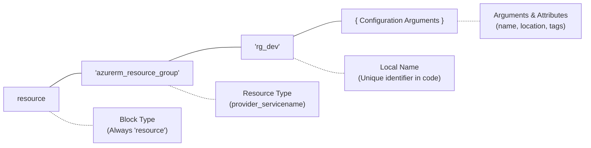
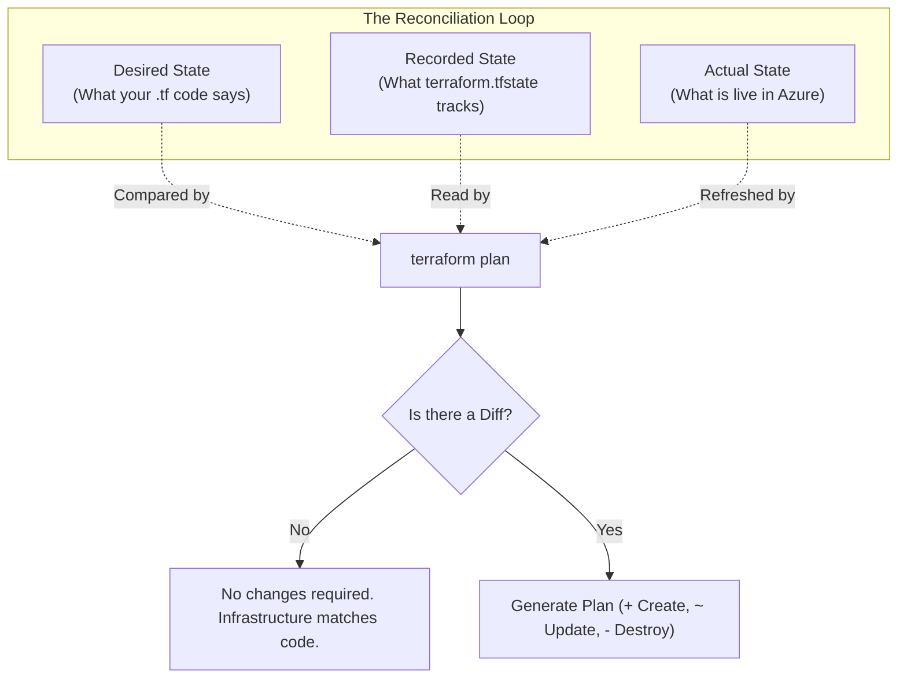
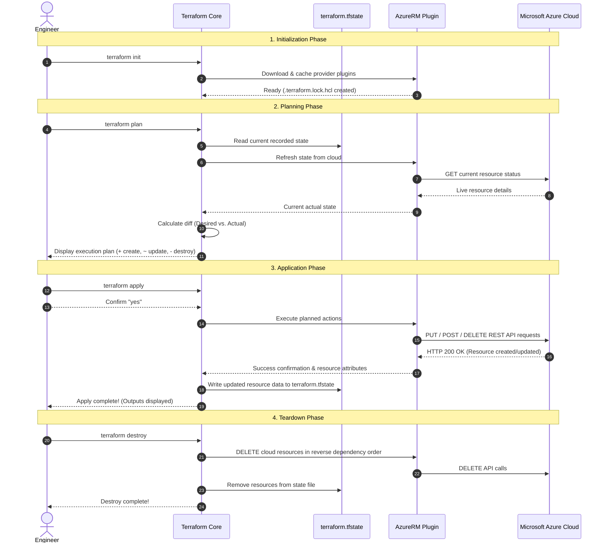

# 📅 Day 03: Core Concepts — Providers, Resources, State & Execution Workflow

[](https://www.terraform.io/)
[](https://registry.terraform.io/providers/hashicorp/azurerm/latest)
[](https://github.com/)

---

## 📌 Overview

On **Day 03**, we dive into the fundamental pillars that power Terraform:
1. **Providers** — The translators between Terraform and target cloud APIs.
2. **Resources** — The declarative building blocks that represent real-world infrastructure.
3. **State** — The single source of truth mapping your code to real infrastructure.
4. **Execution Workflow** — The lifecycle loop (`init` $\rightarrow$ `plan` $\rightarrow$ `apply` $\rightarrow$ `destroy`) that guarantees idempotent deployments.

Understanding how these four components interact is the bridge from running basic commands to designing scalable, production-grade cloud architectures.

---

## 🎯 Day 03 Objectives

- [x] Understand the **Terraform Core vs. Provider Plugin** architecture.
- [x] Master **Resource syntax**, arguments, and exported attributes.
- [x] Demystify **Terraform State (`terraform.tfstate`)** and the reconciliation loop.
- [x] Trace the **4-stage execution workflow** from HCL code to cloud API calls.
- [x] Visualize the complete architecture using clear diagrams.

---

## 🏛️ Terraform High-Level Architecture Diagram

Terraform is split into two distinct layers: **Terraform Core** and **Provider Plugins**.

```mermaid
flowchart TD
    subgraph UserSpace["💻 User Workspace"]
        A["Configuration Files\n(*.tf)"]
        B["Terraform State\n(terraform.tfstate)"]
    end

    subgraph CoreEngine["⚙️ Terraform Core (CLI Engine)"]
        C["Dependency Graph Builder"]
        D["State Management & Diff Engine"]
        E["RPC Interface (gRPC)"]
    end

    subgraph Providers["🔌 Provider Plugins (Downloaded on 'init')"]
        P1["Azure Provider\n(azurerm)"]
        P2["AWS Provider\n(aws)"]
        P3["Kubernetes Provider\n(kubernetes)"]
    end

    subgraph CloudAPIs["☁️ Target Cloud Infrastructure"]
        AP1["Azure ARM REST APIs\n(Resource Groups, VNets, VMs)"]
        AP2["AWS Cloud APIs"]
        AP3["K8s API Server"]
    end

    A --> C
    B <--> D
    C --> D
    D --> E
    E --> P1
    E --> P2
    E --> P3
    P1 <-->|HTTPS / REST| AP1
    P2 <-->|HTTPS / REST| AP2
    P3 <-->|HTTPS / REST| AP3
```



### 1. Terraform Core
- Evaluates your HCL configuration files.
- Reads and updates the state file.
- Builds an **in-memory Directed Acyclic Graph (DAG)** of all resources to determine dependencies and optimal creation order (or parallelization).
- Identifies the delta between desired state and actual state.
- Communicates with Provider Plugins via **gRPC (Remote Procedure Calls)**.

### 2. Provider Plugins
- Standalone executables (written in Go) dynamically downloaded during `terraform init`.
- Serve as translation bridges: they take standard Terraform commands and turn them into target API calls (e.g., Azure Resource Manager REST APIs).

---

## 🔌 1. Deep Dive: Providers

A **Provider** is a plugin that provides the lifecycle management (Create, Read, Update, Delete - CRUD) for resources in a specific platform or service.

### Provider Tiers
| Tier | Description | Example |
| :--- | :--- | :--- |
| **Official** | Maintained directly by HashiCorp | `hashicorp/azurerm`, `hashicorp/aws` |
| **Partner** | Maintained by technology partners with HashiCorp | `datadog/datadog`, `cloudflare/cloudflare` |
| **Community** | Maintained by independent open-source developers | Custom internal tools |

### Provider Syntax in HCL

```hcl
# 1. Declare provider requirement
terraform {
  required_version = ">= 1.5.0"
  required_providers {
    azurerm = {
      source  = "hashicorp/azurerm"
      version = "~> 3.0"
    }
  }
}

# 2. Configure provider settings
provider "azurerm" {
  features {} # Required configuration block for AzureRM
}
```

- `source`: The global registry address in format `<namespace>/<type>`.
- `version`: Version constraint using semantic versioning (`~> 3.0` allows updates up to `< 4.0.0`).
- `features {}`: A mandatory configuration block for the `azurerm` provider to define provider-wide behaviors.

---

## 🧱 2. Deep Dive: Resources

**Resources** are the single most important element in the Terraform language. Each resource block describes one or more infrastructure objects.

### Resource Block Anatomy

```plaintext
resource "azurerm_resource_group" "rg_dev" {
  name     = "rg-dev-eastus"
  location = "East US"

  tags = {
    environment = "dev"
  }
}
```



### Arguments vs. Attributes
- **Input Arguments**: Values you provide to configure the resource (e.g., `name = "rg-dev-eastus"`).
- **Exported Attributes**: Values computed by Azure once the resource is created (e.g., `id`, `location`). You can reference them elsewhere in code using:
  ```hcl
  azurerm_resource_group.rg_dev.id
  ```

---

## 🗄️ 3. Deep Dive: State (`terraform.tfstate`)

The **Terraform State** file is a JSON document that acts as the single source of truth for your infrastructure.



### Why Does Terraform Need State?
1. **Mapping to the Real World**: Connects local configuration blocks (`azurerm_resource_group.rg_dev`) to specific Azure resource IDs (`/subscriptions/.../resourceGroups/rg-dev-eastus`).
2. **Performance Optimization**: Stores cached attributes to avoid querying every API for every resource on every command.
3. **Tracking Dependencies**: Knows what order to safely delete or recreate resources.

> [!CAUTION]
> State files can contain sensitive values (like passwords or private keys) in plain text. Never check `.tfstate` files into public Git repositories. Use a remote backend with encryption.

---

## 🔁 4. Deep Dive: The Execution Workflow

The core operational lifecycle of Terraform consists of four sequential stages:



---

## 🧪 Quick Hands-On Code Example

Here is how all four concepts come together in real code:

### 1. `terraform.tf` (Declares Provider)
```hcl
terraform {
  required_version = ">= 1.5.0"
  required_providers {
    azurerm = {
      source  = "hashicorp/azurerm"
      version = "~> 3.0"
    }
  }
}
```

### 2. `main.tf` (Configures Provider & Defines Resource)
```hcl
# Configure the Azure Provider
provider "azurerm" {
  features {}
}

# Define an Azure Resource
resource "azurerm_resource_group" "example" {
  name     = "rg-day03-demo"
  location = "East US"

  tags = {
    Day         = "03"
    Environment = "Learning"
    ManagedBy   = "Terraform"
  }
}
```

---

## 📊 Summary Comparison

| Concept | What It Is | Analogy | Where It Lives |
| :--- | :--- | :--- | :--- |
| **Provider** | Plugin that talks to a cloud API | The translator / driver | `.terraform/providers/` |
| **Resource** | Declaration of a cloud object | The building block / brick | `*.tf` files |
| **State** | Map of code to real-world objects | The architecture blueprint & inventory | `terraform.tfstate` |
| **Workflow** | Orderly process of changes | The construction process | CLI (`init`, `plan`, `apply`, `destroy`) |

---

## ⏭️ Next Step (Day 04)

Now that you understand the architectural pillars of Terraform:
👉 **Day 04: Hands-on Azure Resource Group Provisioning with `terraform plan` and `terraform apply`!**
