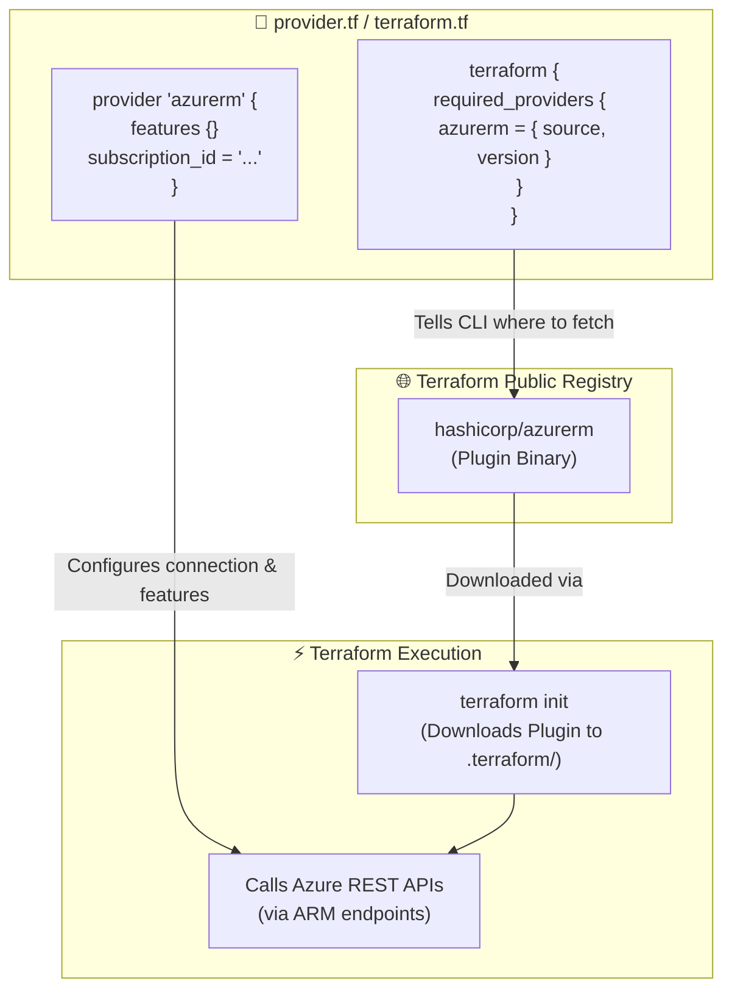
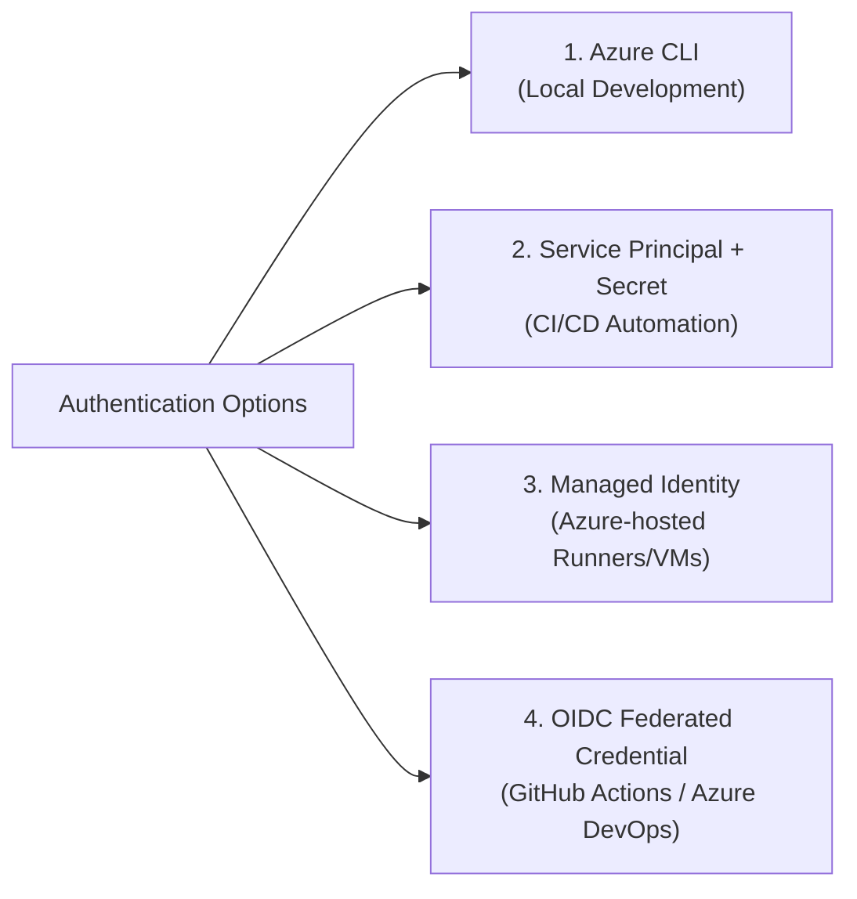

# 📅 Day 04: Configuring the AzureRM Provider in Terraform

[](https://www.terraform.io/)
[](https://registry.terraform.io/providers/hashicorp/azurerm/latest/docs)
[](https://github.com/)

---

## 📌 Overview

On **Day 04** of our Terraform & Azure Learning Journey, we focus deeply on **configuring the AzureRM (Azure Resource Manager) provider**.

The AzureRM provider is the official HashiCorp plugin that allows Terraform to interact with the full suite of Microsoft Azure services through the Azure Resource Manager (ARM) APIs. Properly configuring this provider is the essential foundation for all infrastructure deployed to Azure.

---

## 🎯 Day 04 Objectives

- [x] Understand how Terraform discovers, downloads, and pins the `azurerm` provider.
- [x] Master the `provider "azurerm"` block and why `features {}` is mandatory.
- [x] Learn all four authentication mechanisms for AzureRM.
- [x] Configure multi-region / multi-subscription deployments using **Provider Aliases**.
- [x] Verify configuration using `terraform init` and `terraform validate`.
- [x] Follow enterprise security practices (zero hardcoded secrets).

---

## 🧱 The Anatomy of Provider Configuration

Configuring AzureRM involves two distinct blocks:
1. `terraform { required_providers { ... } }`: **Declares** what plugin to download from the registry.
2. `provider "azurerm" { ... }`: **Configures** runtime behavior, authentication, and features for Azure.



---

## 🔍 Code Breakdown

### 1. The `terraform` Block (Provider Declaration)

```hcl
terraform {
  required_version = ">= 1.5.0"

  required_providers {
    azurerm = {
      source  = "hashicorp/azurerm"
      version = "~> 3.0" # Allows 3.x.x versions, prevents breaking major updates
    }
  }
}
```

- **`source`**: The registry namespace and provider name (`hashicorp/azurerm`).
- **`version`**: Semantic version constraint:
  - `~> 3.0`: Allows updates like `3.100.0`, but blocks `4.0.0` (prevents breaking changes).
  - `>= 3.0, < 4.0`: Range constraint.
  - `= 3.100.0`: Exact pin.

---

### 2. The `provider "azurerm"` Block & `features {}`

```hcl
provider "azurerm" {
  features {}
}
```

### ❓ Why is `features {}` Mandatory?
Unlike many other providers, AzureRM **requires** an explicit `features {}` block, even if empty.

It is used to customize and control specific lifecycle behaviors of Azure resources where cloud defaults might conflict with Terraform's expected state:

```hcl
provider "azurerm" {
  features {
    key_vault {
      purge_soft_delete_on_destroy    = false # Prevents accidental permanent secret loss
      recover_soft_deleted_key_vaults = true
    }
    resource_group {
      prevent_deletion_if_contains_resources = true # Guardrail against accidental deletion
    }
    virtual_machine {
      delete_os_disk_on_deletion = true # Cleans up OS disk when VM is destroyed
    }
  }
}
```

---

## 🔐 AzureRM Authentication Methods

Terraform supports four standard ways to authenticate with Azure:



### Method 1: Azure CLI (Best for Local Development & Learning)
This is the simplest method. Terraform automatically detects your credentials when you log in via the Azure CLI:

```powershell
# 1. Login to Azure
az login

# 2. View current active subscription
az account show --output table

# 3. Set the target subscription (if you have multiple)
az account set --subscription "YOUR_SUBSCRIPTION_ID"
```

In your `provider.tf`, you simply supply:
```hcl
provider "azurerm" {
  features {}
}
```

---

### Method 2: Service Principal with Client Secret (CI/CD Pipelines)
Used by automated deployment pipelines (Jenkins, GitLab CI, older GitHub Actions).

> [!CAUTION]
> **Never hardcode secrets inside `.tf` files!** Use environment variables instead.

Set the credentials as environment variables in your terminal or pipeline:

**In PowerShell:**
```powershell
$env:ARM_CLIENT_ID       = "00000000-0000-0000-0000-000000000000"
$env:ARM_CLIENT_SECRET   = "your-strong-client-secret"
$env:ARM_SUBSCRIPTION_ID = "00000000-0000-0000-0000-000000000000"
$env:ARM_TENANT_ID       = "00000000-0000-0000-0000-000000000000"
```

**In Linux / macOS (Bash):**
```bash
export ARM_CLIENT_ID="00000000-0000-0000-0000-000000000000"
export ARM_CLIENT_SECRET="your-strong-client-secret"
export ARM_SUBSCRIPTION_ID="00000000-0000-0000-0000-000000000000"
export ARM_TENANT_ID="00000000-0000-0000-0000-000000000000"
```

Terraform automatically detects variables prefixed with `ARM_`.

---

### Method 3: Managed Identity (MSI)
If Terraform runs inside an Azure VM, Azure DevOps Self-Hosted Agent, or Azure Cloud Shell with an assigned Managed Identity:

```hcl
provider "azurerm" {
  features {}
  use_msi = true
}
```

---

### Method 4: Workload Identity Federation / OIDC (Modern CI/CD)
The most secure, passwordless authentication for GitHub Actions:
```hcl
provider "azurerm" {
  features {}
  use_oidc = true
}
```

---

## 🔀 Multi-Provider & Multi-Region Setup (Provider Aliases)

When you need to deploy resources across multiple Azure subscriptions or different regions within the same project, use the **`alias`** meta-argument:

```hcl
# Default provider (Primary region)
provider "azurerm" {
  features {}
}

# Secondary provider for Disaster Recovery (DR)
provider "azurerm" {
  alias = "dr_region"
  features {}
}

# Deploy to default provider
resource "azurerm_resource_group" "primary_rg" {
  name     = "rg-primary-eastus"
  location = "East US"
}

# Deploy to secondary provider explicitly
resource "azurerm_resource_group" "dr_rg" {
  provider = azurerm.dr_region
  name     = "rg-dr-westus"
  location = "West US"
}
```

---

## 🚀 Practical Steps: Validating the Provider

In the `day4-configure-azurerm` directory, run:

```powershell
# 1. Initialize working directory & download the provider plugin
terraform init

# 2. Check for syntax correctness and argument integrity
terraform validate

# 3. Format files according to HashiCorp standards
terraform fmt

# 4. Preview the execution plan
terraform plan
```

---

## 🛡️ Security Best Practices

1. **Keep Secrets Out of Version Control**: Never store client secrets, passwords, or tenant IDs in `.tf` files or commit `.tfvars` to GitHub.
2. **Pin Provider Versions**: Always use `~> X.Y` or exact versioning so automated builds don't break when upstream providers release major breaking versions.
3. **Use Least Privilege**: Ensure Service Principals or user accounts have only the required Azure RBAC roles (e.g., Contributor scoped to a specific Resource Group rather than Owner of the entire Tenant).

---

## 📋 Commands Reference (Day 04)

| Command | Purpose |
| :--- | :--- |
| `az login` | Authenticates with Microsoft Azure via browser |
| `az account show` | Verifies current active Azure subscription ID and tenant ID |
| `az account set -s "<ID>"` | Switches the active Azure subscription |
| `terraform init` | Downloads the `azurerm` provider binary into `.terraform/` |
| `terraform validate` | Verifies that provider arguments and blocks are valid |

---

## ⏭️ Next Step (Day 05)
Now that our AzureRM provider is configured and authenticated:  
👉 **Day 05: Mastering Input Variables, Default Values, and Type Constraints!**
