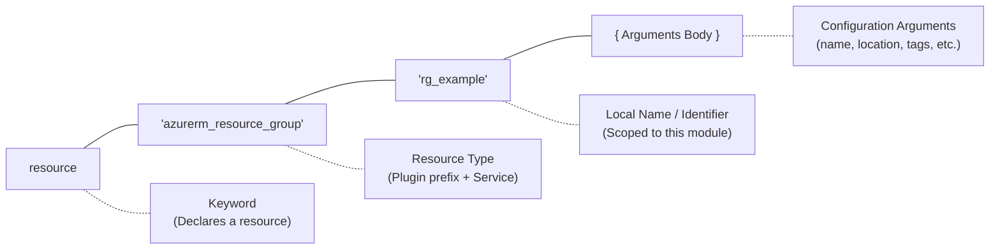
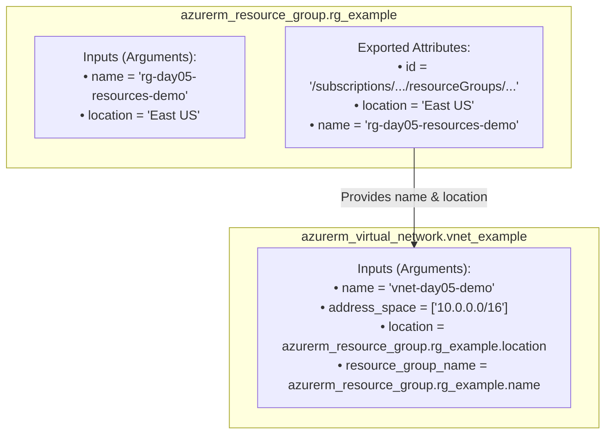

# 📅 Day 05: Terraform Resource Blocks — Arguments vs. Attributes Explained

[](https://www.terraform.io/)
[](https://registry.terraform.io/providers/hashicorp/azurerm/latest)
[](https://github.com/)

---

## 📌 Overview

On **Day 05**, we master the fundamental unit of infrastructure in Terraform: the **`resource` block**.

Every piece of cloud infrastructure managed by Terraform—from an Azure Resource Group to a Virtual Network or Virtual Machine—is declared using a resource block. Understanding the critical difference between **Arguments (inputs)** and **Attributes (outputs/computed values)** is essential for connecting resources together and managing dependencies.

---

## 🎯 Day 05 Objectives

- [x] Understand the anatomical structure of a Terraform `resource` block.
- [x] Differentiate between **Input Arguments** and **Exported Attributes**.
- [x] Learn how **Implicit Dependencies** are created by passing attributes into arguments.
- [x] Explore **Meta-Arguments** (`count`, `for_each`, `depends_on`, `lifecycle`).
- [x] Inspect computed attributes using `terraform show` and `outputs.tf`.

---

## 🏗️ Anatomy of a Resource Block

Every resource block in HCL follows a standardized syntax:

```plaintext
resource "<PROVIDER>_<TYPE>" "<LOCAL_NAME>" {
  # Arguments (Inputs)
  <argument_1> = "<value>"
  <argument_2> = "<value>"
}
```

### Visual Breakdown:



1. **`resource`**: The top-level Terraform keyword indicating we want to manage an infrastructure object.
2. **`azurerm_resource_group`** (Resource Type):
   - `azurerm_`: Specifies the provider plugin responsible for this resource.
   - `resource_group`: Specifies the Azure service/object type.
3. **`rg_example`** (Local Name):
   - A unique label chosen by you to reference this specific block within your Terraform configuration.
   - Together, `<TYPE>.<LOCAL_NAME>` forms the **Resource Address** (e.g., `azurerm_resource_group.rg_example`).
4. **Configuration Body (`{ ... }`)**:
   - Contains the key-value pairs that configure the resource.

---

## 📥 1. What are Resource Arguments? (Inputs)

**Arguments** are the input parameters that **you supply** inside the resource block to instruct Terraform on how to create and configure the resource.

Arguments fall into two main categories:

### A. Provider-Specific Arguments
Defined by the Azure provider documentation for each individual resource type:
- **Required Arguments**: Must be supplied, or Terraform will throw a validation error.
  - *Example for `azurerm_resource_group`*: `name` and `location`.
- **Optional Arguments**: Have sensible defaults or can be omitted if not needed.
  - *Example for `azurerm_resource_group`*: `tags`, `managed_by`.

### B. Meta-Arguments (Universal across all resources)
Special arguments built directly into Terraform Core that work on **any** resource block:

| Meta-Argument | Purpose | Example |
| :--- | :--- | :--- |
| `depends_on` | Explicitly enforces ordering when no direct reference exists | `depends_on = [azurerm_resource_group.rg_example]` |
| `count` | Creates multiple identical or indexed instances of a resource | `count = 3` |
| `for_each` | Creates multiple instances from a map or set of strings | `for_each = toset(["eastus", "westus"])` |
| `provider` | Specifies an alternate or aliased provider configuration | `provider = azurerm.secondary` |
| `lifecycle` | Customizes resource lifecycle behavior | `lifecycle { prevent_destroy = true }` |

---

## 📤 2. What are Resource Attributes? (Outputs / Computed Values)

**Attributes** are read-only properties exposed by the resource **after it is processed or created by Azure**.

### Key Characteristics of Attributes:
- They represent information determined by the cloud platform itself (e.g., auto-generated IDs, GUIDs, IP addresses, endpoint URLs).
- **All input arguments are also available as attributes** once configured.
- Additional **Exported Attributes** (computed by Azure) cannot be set as inputs; they can only be read.

### Example: `azurerm_resource_group`
- **Arguments you provide**: `name = "rg-demo"`, `location = "East US"`.
- **Attributes exported by Azure**:
  - `id`: `/subscriptions/<sub-id>/resourceGroups/rg-demo` (The Azure Resource Manager URI).

### How to Reference an Exported Attribute:
```hcl
<RESOURCE_TYPE>.<LOCAL_NAME>.<ATTRIBUTE_NAME>

# Example:
azurerm_resource_group.rg_example.id
azurerm_resource_group.rg_example.location
```

---

## 🔄 Chaining Resources: Connecting Attributes to Arguments

The most powerful aspect of Terraform is feeding an **exported attribute** from one resource directly into the **input argument** of another resource.



### Code Example:

```hcl
# 1. Base Resource Group
resource "azurerm_resource_group" "rg_example" {
  name     = "rg-day05-resources-demo"
  location = "East US"
}

# 2. Virtual Network referencing Resource Group attributes
resource "azurerm_virtual_network" "vnet_example" {
  name                = "vnet-day05-demo"
  address_space       = ["10.0.0.0/16"]
  
  # ARGUMENTS populated by ATTRIBUTES of rg_example:
  location            = azurerm_resource_group.rg_example.location
  resource_group_name = azurerm_resource_group.rg_example.name
}
```

### Why is this significant? (Implicit Dependency)
By referencing `azurerm_resource_group.rg_example.name`, Terraform automatically understands that:
1. The **Resource Group must be created first**.
2. The **Virtual Network must be created second**.
3. During destruction, the **Virtual Network must be destroyed before the Resource Group**.

You do **not** need to manually add `depends_on`; Terraform infers the relationship from the attribute reference.

---

## ⚖️ Arguments vs. Attributes Comparison

| Feature | Arguments (Inputs) | Attributes (Outputs) |
| :--- | :--- | :--- |
| **Direction** | Inward (User $\rightarrow$ Terraform) | Outward (Azure $\rightarrow$ Terraform $\rightarrow$ User) |
| **Definition** | Written by the developer in `.tf` | Computed by Azure ARM API |
| **Mutability** | Configurable / modifiable | Read-only |
| **Examples** | `name`, `address_space`, `tags` | `id`, `guid`, `private_ip_address` |
| **Usage** | Define how the resource should look | Feed into other resources or export via `outputs.tf` |

---

## 🧪 Hands-On Lab Walkthrough

### 1. Inspect the Configuration Files
In `day5-resource-block`:
- `terraform.tf`: Provider requirements.
- `provider.tf`: AzureRM provider block.
- `main.tf`: Resource Group and Virtual Network definitions.
- `outputs.tf`: Exports resource attributes (`id`, `guid`).

### 2. Format & Initialize
```powershell
terraform fmt
terraform init
```

### 3. Validate Syntax
```powershell
terraform validate
```

### 4. Preview the Plan
Observe how Terraform marks computed attributes as `(known after apply)`:
```powershell
terraform plan
```

*Example Plan Output snippet:*
```plaintext
  # azurerm_resource_group.rg_example will be created
  + resource "azurerm_resource_group" "rg_example" {
      + id       = (known after apply)
      + location = "eastus"
      + name     = "rg-day05-resources-demo"
    }

  # azurerm_virtual_network.vnet_example will be created
  + resource "azurerm_virtual_network" "vnet_example" {
      + guid                = (known after apply)
      + id                  = (known after apply)
      + location            = "eastus"
      + name                = "vnet-day05-demo"
      + resource_group_name = "rg-day05-resources-demo"
    }
```

---

## 💡 Key Best Practices

1. **Reference Attributes Instead of Hardcoding**: Avoid typing `"rg-day05-resources-demo"` twice. Always reference `azurerm_resource_group.rg_example.name` so changes propagate cleanly and dependencies are inferred.
2. **Follow Standard Naming Conventions**:
   - Resource Type: Determined by provider (`azurerm_resource_group`).
   - Local Name: Use concise snake_case identifiers (e.g., `rg_primary`, `vnet_spoke`). Avoid repeating the type in the name (e.g., prefer `rg_core` over `azurerm_resource_group_core`).
3. **Use `outputs.tf` to Verify Attributes**: Always export critical IDs and endpoints to simplify debugging and integrations.

---

## ⏭️ Next Step (Day 06)
Now that you have mastered basic resource blocks, arguments, and attributes:  
👉 **Day 06: Provisioning your first live Azure Resource Group with `terraform apply` & State Verification!**
