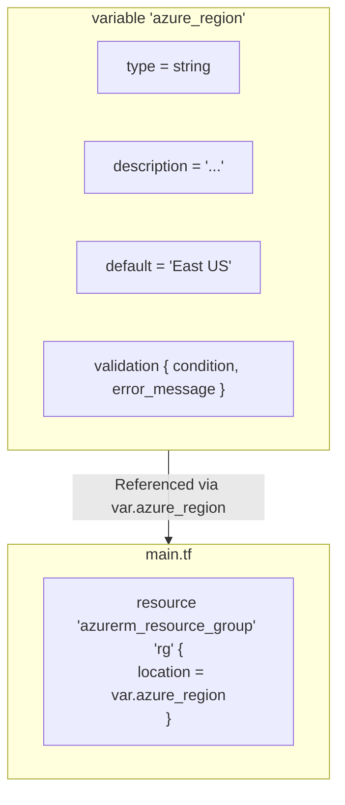
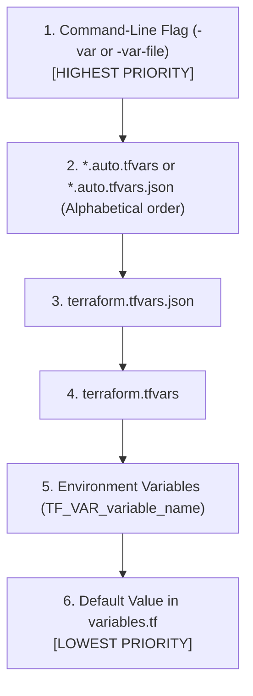

# 📅 Day 06: Input Variables in Terraform (`variables.tf`)

[](https://www.terraform.io/)
[](https://learn.microsoft.com/en-us/azure/developer/terraform/)
[](https://github.com/)

---

## 📌 Overview

On **Day 06**, we solve one of the biggest challenges in Infrastructure as Code: **eliminating hardcoded values**.

Hardcoding values (like region names, CIDR blocks, or resource names) makes your configurations rigid, non-reusable, and error-prone. By introducing **Input Variables** (`variables.tf`), your Terraform code becomes modular, flexible, and capable of deploying identical architectures across multiple environments (`dev`, `staging`, `prod`) with zero code duplication.

---

## 🎯 Day 06 Objectives

- [x] Create a dedicated `variables.tf` file following HashiCorp best practices.
- [x] Master primitive types (`string`, `number`, `bool`) and complex collection types (`list`, `map`).
- [x] Configure variable arguments: `type`, `description`, `default`, and custom `validation` rules.
- [x] Reference variables inside resource blocks using the `var.<name>` syntax.
- [x] Understand **Variable Definition Precedence** (`terraform.tfvars`, CLI flags `-var`, environment variables `TF_VAR_*`).
- [x] Verify configurations with `terraform plan` using custom variable values.

---

## 🧱 Anatomy of a Variable Block

In Terraform, an input variable is declared using the `variable` keyword:

```hcl
variable "azure_region" {
  type        = string                                 # Data type constraint
  description = "The Azure region for all resources"   # Human-readable documentation
  default     = "East US"                              # Fallback value if none provided
  sensitive   = false                                  # Set true for passwords/keys (masks CLI output)

  validation {
    condition     = contains(["East US", "West Europe"], var.azure_region)
    error_message = "The azure_region must be either 'East US' or 'West Europe'."
  }
}
```



---

## 📊 Supported Data Types in Terraform

| Type Category | Type | Example Declaration | Example Value |
| :--- | :--- | :--- | :--- |
| **Primitive** | `string` | `type = string` | `"East US"`, `"rg-dev"` |
| **Primitive** | `number` | `type = number` | `3`, `8080`, `22` |
| **Primitive** | `bool` | `type = bool` | `true`, `false` |
| **Complex Collection**| `list(string)` | `type = list(string)` | `["10.0.0.0/16", "192.168.0.0/16"]` |
| **Complex Collection**| `map(string)` | `type = map(string)` | `{ env = "dev", team = "devops" }` |
| **Complex Structural**| `object({...})`| `type = object({ name = string, port = number })` | `{ name = "http", port = 80 }` |

---

## 🔍 How Variables Are Consumed in `main.tf`

To use an input variable in your configuration, prefix the variable name with `var.`:

```hcl
# Accessing string variables
resource "azurerm_resource_group" "rg" {
  name     = "${var.resource_group_name}-${var.environment}"
  location = var.azure_region
  tags     = var.tags
}

# Accessing list variables
resource "azurerm_virtual_network" "vnet" {
  name                = "vnet-${var.environment}-01"
  resource_group_name = azurerm_resource_group.rg.name
  location            = azurerm_resource_group.rg.location
  address_space       = var.vnet_address_space # e.g. ["10.10.0.0/16"]
}

# Accessing boolean variables with conditional operator
resource "azurerm_subnet" "subnet" {
  count                = var.create_subnet ? 1 : 0
  name                 = "snet-${var.environment}-web"
  resource_group_name  = azurerm_resource_group.rg.name
  virtual_network_name = azurerm_virtual_network.vnet.name
  address_prefixes     = var.subnet_prefixes
}
```

---

## ⚡ How to Pass Variable Values (Precedence Order)

When multiple sources provide a value for the same variable, Terraform resolves them according to a strict priority hierarchy (from highest to lowest priority):



### Examples of Passing Values:

#### 1. Via `terraform.tfvars` (Standard Practice)
Create a `terraform.tfvars` file in the same directory:
```hcl
environment         = "staging"
azure_region        = "West Europe"
vnet_address_space  = ["172.16.0.0/16"]
```
Run standard plan:
```powershell
terraform plan
```

#### 2. Via CLI Command-Line Flag (`-var`)
Overrides file definitions on the fly:
```powershell
terraform plan -var="environment=prod" -var="azure_region=West US"
```

#### 3. Via Environment Variables (`TF_VAR_<name>`)
Useful in CI/CD pipelines (GitHub Actions, Azure DevOps):
```powershell
# In PowerShell:
$env:TF_VAR_environment = "prod"
$env:TF_VAR_azure_region = "East US"

terraform plan
```

---

## 🧪 Hands-On Lab Walkthrough

### 1. Inspect Files in `day6-variables`:
- `variables.tf`: Contains all input variable declarations and validation rules.
- `main.tf`: Uses `var.*` to configure RG, VNet, and Subnet.
- `terraform.tfvars`: Sample values for custom overrides.
- `outputs.tf`: Prints resulting values.

### 2. Format & Validate:
```powershell
terraform fmt
terraform validate
```

### 3. Test Validation Rules:
If you supply an invalid region, Terraform enforces the validation block immediately during planning:
```powershell
terraform plan -var="azure_region=InvalidRegion"
```
**Output:**
```plaintext
Error: Invalid value for variable
  on variables.tf line 18:
  The azure_region must be one of: East US, East US 2, West US, West Europe, Central India.
```

### 4. Run Normal Plan with Default Values:
```powershell
terraform plan
```

---

## 🛡️ Best Practices for Input Variables

1. **Always Include `description`**: Future teammates and documentation generators rely on clear descriptions.
2. **Always Explicitly Declare `type`**: Prevents accidental type coercion and confusing runtime errors.
3. **Use `sensitive = true` for Passwords/Secrets**: Prevents values from being printed in plain text during `terraform plan` and `terraform apply`.
4. **Group Variables Logically**: Keep all declarations in `variables.tf` and environment values in `*.tfvars` files. Never declare variables inside `main.tf`.

---

## ⏭️ Next Step (Day 07)
Now that your configurations are flexible and parameter-driven:  
👉 **Day 07: Local Values (`locals`) & Resource Outputs (`outputs.tf`)!**
