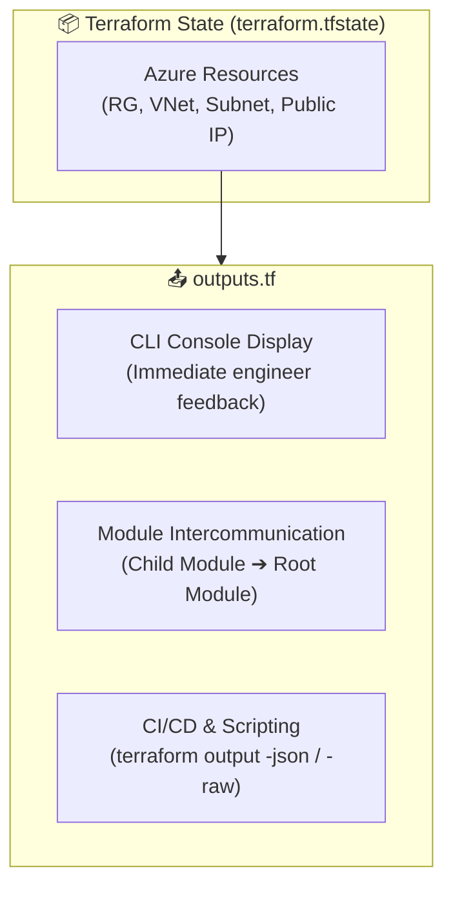

# 📅 Day 07: Terraform Outputs (`outputs.tf`) & Resource Attributes

[](https://www.terraform.io/)
[](https://learn.microsoft.com/en-us/azure/developer/terraform/)
[](https://github.com/)

---

## 📌 Overview

On **Day 07**, we focus on extracting and exposing useful information from our provisioned cloud infrastructure using **Output Values** (`outputs.tf`).

When Terraform finishes provisioning resources in Microsoft Azure, you often need immediate access to critical computed data—such as **Public IP addresses**, **Fully Qualified Domain Names (FQDNs)**, **Resource IDs**, and **Subnet IDs**. Outputs allow you to display this data directly in your console, pass it to downstream automation, or share it between decoupled modules.

---

## 🎯 Day 07 Objectives

- [x] Create a dedicated, standardized `outputs.tf` file.
- [x] Understand the 3 primary use cases for Terraform output values.
- [x] Extract both input values and cloud-computed attributes (e.g. `ip_address`, `fqdn`, `id`).
- [x] Create **Structured / Composite Outputs** (maps and objects) for clean summaries.
- [x] Master the **`sensitive = true`** argument to protect credentials and connection strings.
- [x] Practice querying outputs with `terraform output`, `terraform output -raw`, and `terraform output -json`.

---

## 💡 The 3 Primary Use Cases for Outputs



1. **CLI User Feedback**: Displays endpoints, connection instructions, and IDs immediately after `terraform apply` finishes without needing to open the Azure Portal.
2. **Modular Architecture**: Allows a child module to expose attributes to the parent root module (e.g. a networking module exposing `vnet_id` to a VM compute module).
3. **Pipeline Automation & Integration**: Enables shell scripts, Ansible playbooks, and GitHub Actions pipelines to programmatically query infrastructure details using `terraform output -json`.

---

## 🧱 Anatomy of an `output` Block

```hcl
output "public_ip_address" {
  description = "The allocated public IPv4 address"  # Human documentation
  value       = azurerm_public_ip.pip.ip_address       # Expression / Attribute to export
  sensitive   = false                                  # Set true to mask from console output
  depends_on  = []                                     # Explicit dependency (rarely needed)
}
```

- **`output "<NAME>"`**: The unique name used to reference this value.
- **`description`**: Documents what the output represents.
- **`value`** *(Required)*: The HCL expression referencing resource attributes or variables.
- **`sensitive`** *(Optional)*: When `true`, Terraform hides the value in CLI output (`<sensitive>`) and prevents accidental credential leaks in console logs.

---

## 🔍 Types of Outputs Demonstrated in Day 07

### 1. Primitive Scalar Outputs
Exporting single strings, numbers, or booleans:
```hcl
output "resource_group_name" {
  description = "The deployed name of the Azure Resource Group"
  value       = azurerm_resource_group.rg.name
}

output "public_ip_address" {
  description = "The allocated public IPv4 address"
  value       = azurerm_public_ip.pip.ip_address
}
```

### 2. List Outputs
Exporting array attributes:
```hcl
output "vnet_address_space" {
  description = "The address space CIDR block(s) assigned to the VNet"
  value       = azurerm_virtual_network.vnet.address_space
}
```

### 3. Structured / Composite Outputs (Maps / Objects)
Group related attributes together for a clean, unified summary:
```hcl
output "web_tier_summary" {
  description = "Consolidated summary of web-tier networking attributes"
  value = {
    resource_group = azurerm_resource_group.rg.name
    vnet_name      = azurerm_virtual_network.vnet.name
    subnet_name    = azurerm_subnet.frontend.name
    public_ip      = azurerm_public_ip.pip.ip_address
    fqdn           = azurerm_public_ip.pip.fqdn
    nsg_name       = azurerm_network_security_group.nsg.name
  }
}
```

### 4. Sensitive Outputs (Security Protection)
For database connection strings, TLS certificates, or initial admin passwords:
```hcl
output "simulated_db_connection_string" {
  description = "Simulated connection string demonstrating the sensitive flag"
  value       = "Server=${azurerm_public_ip.pip.ip_address};Database=appdb;User Id=dbadmin;Password=SuperSecretP@ssw0rd!;"
  sensitive   = true
}
```

> [!NOTE]
> When `sensitive = true` is set, Terraform displays:
> ```plaintext
> simulated_db_connection_string = <sensitive>
> ```
> To reveal the value explicitly when authorized, run:
> ```powershell
> terraform output -raw simulated_db_connection_string
> ```

---

## 💻 Working with the `terraform output` CLI Command

You do not need to run `terraform apply` just to view outputs again. You can query them at any time:

### 1. View All Outputs
```powershell
terraform output
```

**Example Output:**
```plaintext
public_ip_address = "20.120.45.18"
public_ip_fqdn = "day07-web-dev.eastus.cloudapp.azure.com"
resource_group_id = "/subscriptions/.../resourceGroups/rg-day07-outputs-demo-dev"
resource_group_location = "eastus"
resource_group_name = "rg-day07-outputs-demo-dev"
simulated_db_connection_string = <sensitive>
subnet_id = "/subscriptions/.../subnets/snet-dev-frontend"
vnet_address_space = [
  "10.70.0.0/16",
]
vnet_id = "/subscriptions/.../virtualNetworks/vnet-dev-01"
vnet_name = "vnet-dev-01"
web_tier_summary = {
  "fqdn" = "day07-web-dev.eastus.cloudapp.azure.com"
  "nsg_name" = "nsg-dev-web"
  "public_ip" = "20.120.45.18"
  "resource_group" = "rg-day07-outputs-demo-dev"
  "subnet_name" = "snet-dev-frontend"
  "vnet_name" = "vnet-dev-01"
}
```

### 2. Query a Specific Output
```powershell
terraform output public_ip_address
# "20.120.45.18"
```

### 3. Extract Raw Strings (Ideal for Scripts & Automation)
Strip quotation marks for direct piping to other tools:
```powershell
terraform output -raw public_ip_address
# 20.120.45.18
```

### 4. Export as JSON (Ideal for `jq` / Python / CI/CD)
```powershell
terraform output -json
```

---

## 🧪 Hands-On Lab Walkthrough

### 1. Inspect Files in `day7-output`:
- `variables.tf`: Base input configurations.
- `main.tf`: Resources (Resource Group, VNet, Subnet, Public IP, NSG).
- `outputs.tf`: The output definitions exporting attributes.

### 2. Format & Validate:
```powershell
terraform fmt
terraform validate
```

### 3. Plan & Observe Expected Outputs:
```powershell
terraform plan
```
Notice how at the bottom of the plan, Terraform explicitly previews all the outputs that will be generated:
```plaintext
Changes to Outputs:
  + public_ip_address              = (known after apply)
  + public_ip_fqdn                 = (known after apply)
  + resource_group_id              = (known after apply)
  + ...
```

---

## 🛡️ Best Practices for Outputs

1. **Always Include `description`**: Document what the output provides and which team or application consumes it.
2. **Mask Secrets with `sensitive = true`**: Prevent accidental leaks of keys, tokens, or connection strings into pipeline logs.
3. **Prefer Granular and Grouped Outputs**: Provide individual attributes (`public_ip_address`) alongside structured summaries (`web_tier_summary`) to satisfy both script automation and human inspection.
4. **Treat Outputs as Module Public APIs**: When writing reusable modules, outputs define the public contract of your module.

---

## ⏭️ Next Step (Day 08)
Now that you can input variables and extract computed outputs:  
👉 **Day 08: Azure Virtual Networks (VNet), Subnets & Network Security Groups (NSGs)!**
